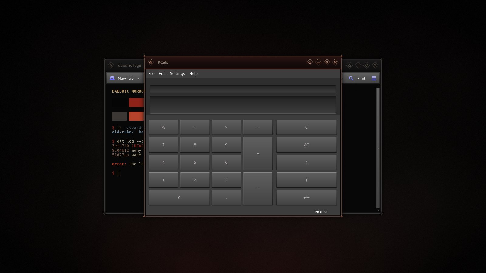
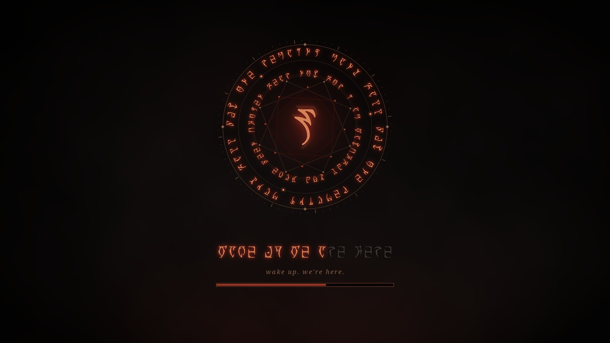
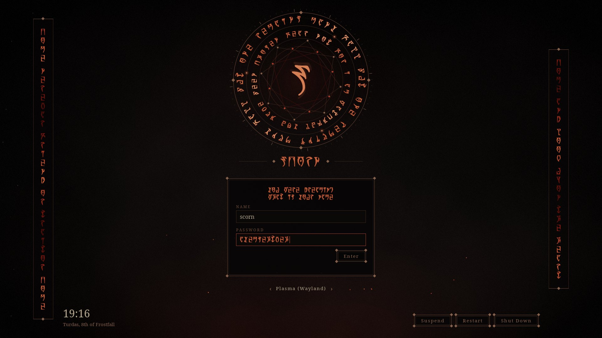
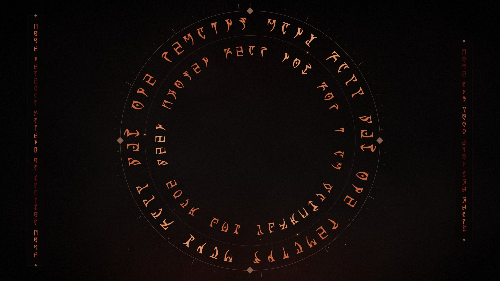
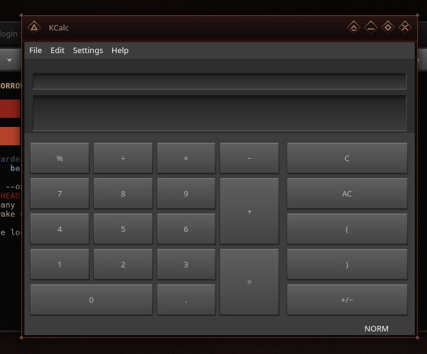
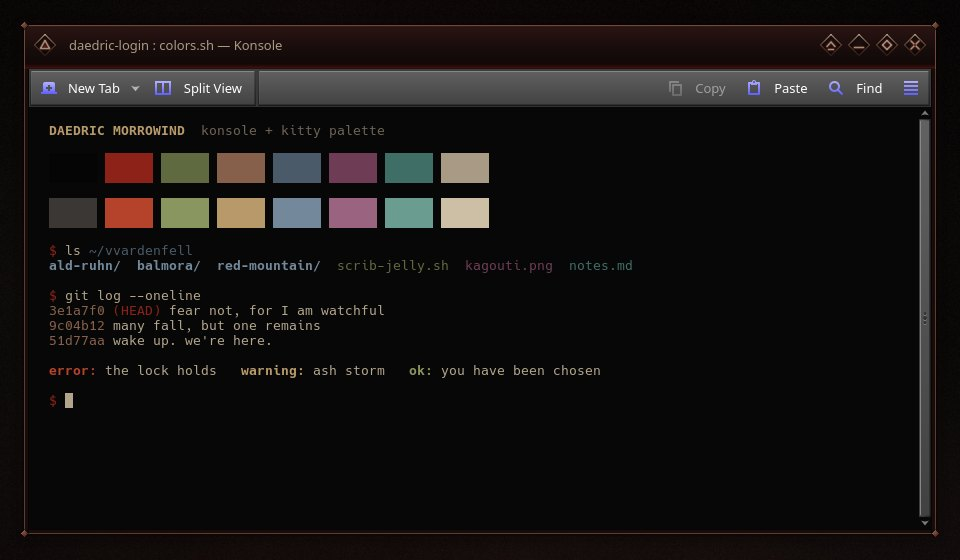

# Daedric Morrowind

A very dark Morrowind shrine theme for KDE Plasma 6, from boot to desktop: basalt-black, dim bronze, ash-bone and ember, with **real Daedric script**. Every rune is set in **OMW Ayembedt** by Georg Duffner (SIL Open Font License 1.1), which maps the Latin letters A–Z onto the Daedric alphabet, so each inscription is a readable phrase.

This repo is the hub for the suite. Each piece lives in its own repo and can be installed on its own; `install.sh` here fetches and installs all of them.

## The suite

| | piece | repo | needs root |
|---|---|---|---|
|  | **Plymouth boot splash.** A layered sigil whose inscription ignites as the system boots. | [daedric-morrowind-plymouth](https://github.com/numbpill3d/daedric-morrowind-plymouth) | yes |
|  | **SDDM login.** Animated rings of live Daedric script; your username and password are drawn in runes as you type. | [daedric-morrowind-sddm](https://github.com/numbpill3d/daedric-morrowind-sddm) | yes |
|  | **Plasma splash screen.** The same sigil, igniting as the desktop loads. | [daedric-morrowind-splash](https://github.com/numbpill3d/daedric-morrowind-splash) | no |
|  | **Lock screen wallpaper.** Large turning rings of Daedric script around the clock and password field. | [daedric-morrowind-lockscreen](https://github.com/numbpill3d/daedric-morrowind-lockscreen) | no |
|  | **Aurorae window decoration.** Near-black oxblood title bar, bronze hairlines, diamond studs and softly glowing buttons. | [daedric-morrowind-aurorae](https://github.com/numbpill3d/daedric-morrowind-aurorae) | no |
|  | **Konsole + kitty colours.** Ash-bone on near-black, sixteen muted colours led by dried-blood red and bronze. | [daedric-morrowind-konsole](https://github.com/numbpill3d/daedric-morrowind-konsole) | no |

## Install everything

    git clone https://github.com/numbpill3d/daedric-morrowind
    cd daedric-morrowind
    ./install.sh --apply

Run it as your normal user. It clones the six piece repos into `pieces/`, installs the four desktop pieces for you, then asks for `sudo` to install the SDDM login and Plymouth boot splash (this rebuilds the initramfs with whatever your distro uses: dracut, mkinitcpio or update-initramfs).

| option | does |
|---|---|
| *(none)* | install everything; select the desktop pieces yourself in System Settings |
| `--apply` | install everything and switch on the splash, lock screen and window decoration |
| `--user-only` | only the four pieces that need no root |
| `--system-only` | only SDDM + Plymouth |

Run it again later to pull updates. The terminal colours are installed but never forced on: pick **DaedricMorrowind** in your Konsole profile, or `include daedric-morrowind.conf` in `kitty.conf`.

## Requirements

KDE Plasma 6, SDDM with the Qt6 greeter, Plymouth, and `git`. The Daedric font is bundled where it is needed; Latin text uses Noto Serif.

## Palette

| name | hex |
|---|---|
| void | `#060505` |
| bronze | `#6e4a38` / `#86604a` / `#3a261d` |
| ash-bone | `#b3a58c` |
| rune | `#c2633c` (crest `#e39a6a`) |
| ember | `#a8402a` |
| flame | `#7d1d15` |
| blood | `#3f0e0b` |

## Credits and licence

By splicer scorn (voidrane). GPL-3.0-or-later. Daedric font: OMW Ayembedt by Georg Duffner, SIL OFL 1.1.

Unofficial fan work. The Elder Scrolls and Morrowind are trademarks of their owner.
